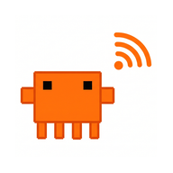

<div align="center">
  

  # Claude SSH

  A mobile client for running **Claude Code** on your VPS over SSH —
  built for the phone, not a ported desktop terminal.

  [](https://github.com/alejandrorodm/ClaudeSSH/releases/latest/download/claude-ssh-release.apk)
  [](https://github.com/alejandrorodm/ClaudeSSH/releases/latest)
  [](#)
  [](#)
</div>

---

## Why

Generic SSH clients are built around a raw terminal — tiny text, no real
keyboard shortcuts, nothing aware of what you're actually running. Claude SSH
is built around one job: talking to **Claude Code** on a remote server from a
phone, without losing any of its features.

## Features

### Terminal sessions
- Real interactive `claude` sessions over SSH, not a stripped-down print
  mode — permission prompts, slash commands and questions all work exactly
  as they do on a desktop.
- **Tabs**: run several sessions, on several folders or several servers, side
  by side.
- **Permission modes** (Plan / Build / Auto) as a single tap, mapped to
  Claude Code's `--permission-mode`.
- A **key bar** for what a phone keyboard doesn't have: `Esc`, `Tab`,
  `⇧Tab`, arrows, `Ctrl-C`, `Ctrl-D`, `Ctrl-L`.
- **Quick commands**: `/clear`, `/compact`, `/usage`, `/model` in one tap.
- **One-tap replies** when Claude shows a numbered permission prompt
  ("1. Yes", "2. No", …) — no need to reach for the number row.
- **Auto-reconnect** after a dropped connection, with backoff, before
  falling back to a manual "Resume" button.
- **Search & copy** across a session's output, and an adjustable terminal
  font size (handy for commands like `/usage` that need more columns).

### Files
- Browse the remote filesystem over SFTP.
- **Download** a file to your phone and share/save it from there.
- **Upload** a file from your phone straight into the folder you're
  browsing.

### Servers
- Save as many VPS profiles as you like — password or private key auth.
- **Duplicate** a server to spin up a variant (different folder, different
  mode) without retyping everything.
- **Export / import** your server list as JSON to move between phones.
  Passwords and private keys are never included — only secure, on-device
  storage ever holds those.

### Background & notifications
- A background-friendly session: a lightweight Android foreground service
  keeps the connection from being frozen or killed while you're in another
  app.
- Status-bar notifications when a session finishes or needs your input,
  with a small Claude-mascot icon per state.
- **Keeps the screen on** while a Claude process is actively running.
- A home-screen **shortcut** (long-press the app icon) to jump straight
  back into your last session.

### Security
- Server secrets live in the platform's secure storage, never in plain
  preferences, never in an export file.
- Optional **biometric / PIN lock** on launch — off by default, and the
  toggle can't be turned on without first passing that same check, so it
  can never lock you out of your own app.
- Trust-on-first-use host key verification: an unexpected host key change
  is refused, not silently accepted.

## Download

Grab the latest APK from **[Releases](https://github.com/alejandrorodm/ClaudeSSH/releases/latest)**
or tap the badge at the top of this page. It's a direct download — open it
on your phone, allow installing from unknown sources if asked, and install.

> The APK is signed with Flutter's default debug-style key, which is fine
> for installing on your own device but is **not** a Play Store release
> build.

## Building from source

```bash
flutter pub get
flutter test              # 30+ unit and widget tests
flutter analyze
./tool/build_release.sh   # outputs claude-ssh-release.apk
```

Requires Flutter (stable), a JDK, and the Android SDK (`flutter doctor` will
point out anything missing).

## How it talks to Claude

Each tab opens a real interactive `claude` process over SSH with a PTY —
the same thing you'd get typing `claude` in a terminal on the VPS itself,
just rendered with [`xterm`](https://pub.dev/packages/xterm) and wrapped in
controls meant for a touchscreen. Nothing about Claude Code is re-implemented
or guessed at: the phone is a window onto the real CLI running on your
server.

## Screenshots

Not included yet — this build was put together without an Android device or
emulator on hand to capture real ones. Happy to add them once run on an
actual phone; contributions welcome.

## Status

Built, unit-tested, and compiled successfully, but **not yet verified on a
physical device or against a live VPS**. Treat it as an early build: the
core SSH/terminal flow is the most exercised path, background survival and
the security features are the least.

## License

No license has been chosen yet — all rights reserved by default until one
is added.
